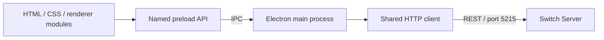

<div align="center">

# Switch · Desktop

**A desktop view of your Ethernet switching lab.**

Inspect ports, follow learned MAC addresses, and manage the Switch server from an Electron dashboard.

[Getting started](#getting-started) · [Using the app](#using-the-app) · [Development](docs/DEVELOPMENT.md) · [Backend server](https://github.com/Gh0st3r0k/Switch-SERVER)


</div>

---

## Overview

This is the desktop companion to [Switch Server](https://github.com/Gh0st3r0k/Switch-SERVER), built for the **PSIP course at FIIT STU**. It uses Electron with plain HTML, CSS, and JavaScript; there is no frontend build step.

| Screen          | What you can do                                                          |
| --------------- | ------------------------------------------------------------------------ |
| Login           | Connect using the server's demo credentials.                             |
| Dashboard       | View discovered ports, their availability, and learned MAC addresses.    |
| Port statistics | Inspect incoming and outgoing counters for each supported protocol.      |
| Settings        | Change the display name and MAC lifetime, or reset entries and counters. |

## Getting started

### Requirements

- **Node.js 22 or 24 LTS** and npm. Node.js 24 was used for cloud validation.
- A graphical desktop supported by Electron, or a virtual X display for headless development.
- A running [Switch Server](https://github.com/Gh0st3r0k/Switch-SERVER#readme) on the same machine, listening on **port 5215**.

### Install and run

From the repository root:

```sh
npm ci
npm start
```

Start the backend before logging in. The client connects to `http://localhost:5215/api`; the address is defined in `src/api.js`.

| Demo field | Value         |
| ---------- | ------------- |
| Username   | `admin`       |
| Password   | `password123` |

> Login is a classroom demonstration. The server uses fixed credentials and does not issue sessions or enforce API authorization. Use a trusted local or isolated lab environment.

## Using the app

1. **Log in.** Enter the demo credentials and press Log In or Enter.
2. **Inspect the dashboard.** Select a port to open its protocol statistics. Green indicates an online port; red indicates an offline or unavailable port.
3. **Watch MAC learning.** The table merges established and newly learned entries. “Last Seen” displays the timestamp reported by the server.
4. **Adjust settings.** Set the MAC lifetime to **1–100 seconds**, change the switch display name, or clear counters and learned addresses.

An empty port list can be expected on machines without eligible adapters. The current server targets Ethernet adapter names used in the original Windows lab; a typical Linux `eth0` is excluded.

## Architecture



Renderers have context isolation enabled and Node integration disabled. The preload script exposes specific operations; all HTTP requests run in the main process.

```text
src/
├── api.js              HTTP requests, timeouts, and response handling
├── main.js             Window lifecycle and IPC handlers
├── preload.js          Explicit renderer bridge
├── shared/             Polling and status-indicator helpers
├── logIn/              Login screen
├── mainPage/           Ports and MAC table
├── settingPage/        Switch settings
└── statisticPage/      Per-port counters
test/                   HTTP client regression tests
docs/                   Development and troubleshooting guide
```

## Development

```sh
npm test
```

The tests use Node's built-in runner and cover login, request payloads, response handling, and failure paths. They do not launch Electron. The [development guide](docs/DEVELOPMENT.md) describes desktop checks and headless startup.

## Troubleshooting

| Symptom                        | Check                                                                           |
| ------------------------------ | ------------------------------------------------------------------------------- |
| Login fails                    | Confirm the server is running on port 5215 and the demo credentials match.      |
| Ports are empty                | Check backend adapter eligibility and packet-capture permissions.               |
| Electron cannot open a display | Start it in a graphical session or use the documented virtual-display workflow. |
| Linux shared-library error     | Install Electron's native desktop dependencies for your distribution.           |
| Values disappear after restart | The server keeps settings, counters, and MAC entries in memory.                 |

---

Created by **Kostiantyn Zaitsev** · FIIT STU · PSIP semester project.
